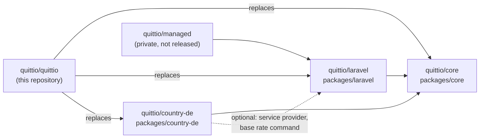
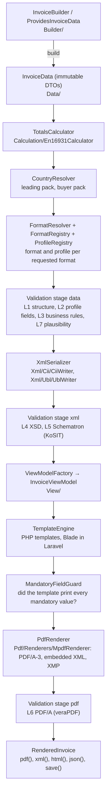
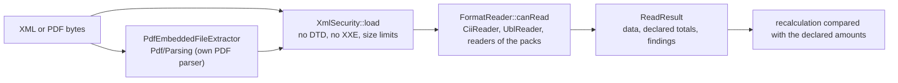

# Architecture

This page is for contributors. It shows how an invoice travels through Quittio, where the extension points are and how the packages depend on each other. For using Quittio, read the [documentation](https://docs.quittio.dev); for the reasons behind the larger decisions, read the [decision records](docs/adr/README.md).

## Packages

- **`quittio/core`** is country-neutral and framework-free. It depends on `brick/math`, `brick/money`, `mpdf/mpdf`, `setasign/fpdi`, `league/commonmark`, `nesbot/carbon` and `psr/log`, never on Laravel.
- **`quittio/laravel`** depends on core and Laravel 13. It builds the core from `config/quittio.php` and adds the facade, events, Blade templates, storage, the queue job, the preview route and the Artisan commands.
- **`quittio/country-de`** depends on core only. `src/Laravel` (service provider and `quittio:base-rate:update`) is used when Laravel is installed and is auto-discovered by Laravel; `laravel/framework` is only suggested.
- **`quittio/quittio`** is the root `composer.json`: all three packages in one, released in lockstep ([ADR 0001](docs/adr/0001-monorepo-with-lockstep-versions.md)).
- **`quittio/managed`** (issuer profiles, numbering, archive, audit log) lives in a private repository and depends on the Laravel package ([ADR 0004](docs/adr/0004-open-core.md)).

Dependencies point one way: core knows nothing about Laravel or Germany. Everything German (VAT presets, UStG rules, XRechnung, DIN 5008, base rate) is in the country pack. Two places still name XRechnung in core: the formats `xrechnung-cii`/`xrechnung-ubl` in `FormatRegistry::withDefaults()` and the XRechnung fields of `InvoiceData`.

## Rendering an invoice

`Quittio::render()` (`packages/core/src/Quittio.php`) runs the steps above:

1. **Build.** `InvoiceBuilder::build()` turns builder calls into an `InvoiceData` tree of `final readonly` DTOs. Every EN 16931 field carries its business term (`#[Bt]`), cardinality and CII/UBL paths as attributes (`Mapping/Attributes`), which feed the [field reference](docs/field-reference.md) and the JSON schema.
2. **Calculate.** `En16931Calculator` computes line amounts, document allowances and charges, the VAT breakdown and the totals with `BigDecimal` and `Money` ([ADR 0003](docs/adr/0003-no-floats.md)). Data read from XML keeps its declared amounts (`Calculation/DeclaredAmounts`).
3. **Resolve countries.** `DefaultCountryResolver` picks the leading country pack (seller's country, or the configured country) and the buyer's pack for cross-border rules.
4. **Choose format and profile.** Without a requested format, the `FormatResolver` asks the format rules of the leading pack (e.g. XRechnung for a Leitweg-ID) and falls back to the configured profile. Profiles that the invoice outgrows (sub lines → EXTENDED) are upgraded where the format allows it. Several formats in one call share one calculation.
5. **Validate the data** (stage `data`): `PhpRulesDriver` runs `StructureRules` (L1), `FieldMatrixRule` (L2), `En16931Rules`, `VatCategoryRules`, `CodeListRules`, `QuittioRules`, the rules of the profile and of the leading and buyer packs (L3) and `PlausibilityRules` (L7). In mode `error` an invalid result throws `ValidationException` before anything is written.
6. **Write the XML** with the serializer of the format's syntax and validate it (stage `xml`): `XsdValidator` (L4) and, when configured, `KositValidator` (L5, Java).
7. **Render the view.** `ViewModelFactory` builds the view model; the template engine renders HTML. `MandatoryFieldGuard` compares the values the template read with the mandatory output of the pack (`CountryPack::mandatoryOutput()`).
8. **Render the PDF.** `MpdfRenderer` writes PDF/A-3 with the embedded XML and XMP metadata in one pass. Renderers that cannot (`supportsEmbedding() === false`) get `MpdfPostProcessor` afterwards. The PDF is validated in stage `pdf` (`VeraPdfValidator`, L6, Docker or a local veraPDF).

`Quittio::prepare()` and `check()` run steps 1 to 6 without template and PDF. `Quittio::renderDocument()` renders quotes, delivery notes and other documents (`Documents/`) through the same view and PDF steps, without XML and without validation.

## Reading an invoice

`InvoiceReader` (`packages/core/src/Reading`) extracts the XML from a PDF without executing it, loads it with `XmlSecurity`, lets the first `FormatReader` that recognises it map it to `InvoiceData`, detects the profile from BT-24, recalculates the totals and reports differences as findings instead of correcting them. `Quittio::validateFile()` runs the configured validation drivers on the result.

## Extension points

| What | Interface | Register in core | Register in Laravel |
|---|---|---|---|
| Country pack | `Countries\CountryPack` (base: `AbstractCountryPack`) | `Quittio::create(countryPacks: …)`, `registerCountry()` | auto-discovery from `extra.quittio.country-packs` in a package's `composer.json`, `quittio.countries`, `Quittio::registerCountry()` |
| Validation driver | `Validation\ValidationDriver` | `withValidator()` | `Quittio::extend('validator', $name, …)` plus the name in `quittio.validation.levels` |
| PDF renderer | `Pdf\PdfRenderer` | `withRenderer()` | `Quittio::extend('renderer', …)`, `quittio.pdf.renderer` |
| XML writer | `Xml\XmlSerializer` | `withSerializer()` (one per syntax) | `Quittio::extend('serializer', …)` |
| Format choice | `Formats\FormatResolver` | `withFormatResolver()` | `Quittio::extend('format_resolver', …)`, `quittio.format_resolver.driver`; `peppol_lookup` for the default resolver |
| Templates | `Templates\TemplateEngine` | `withTemplateEngine()` | Blade views, `php artisan make:quittio-template` |
| Totals | `Calculation\TotalsCalculator` | constructor of `Quittio` | – |
| Incoming formats | `Reading\FormatReader` | `CountryPack::readers()` | the same |
| Stored snapshots | `Serialization\Snapshots\SnapshotUpcaster` | `SnapshotUpcasterChain` | `quittio.snapshots.upcasters` |
| Payment QR code | `Pdf\Qr\PaymentQrGenerator` | `withPaymentQrGenerator()`, `CountryPack::paymentQr()` | `quittio.pdf.payment_qr.generator` |
| Builder | `Support\Macroable` | `InvoiceBuilder::macro()` | the same |

A country pack may add or tighten rules, but never relax EN 16931 (`CountryPack` docblock). Profiles of a pack (e.g. XRechnung in `packages/country-de/src/Profiles`) are registered with the pack.

## Laravel layer

`QuittioManager` (`packages/laravel/src/Laravel/QuittioManager.php`) is the root of the facade. It maps `config/quittio.php` to a core `Config` (`Support/ConfigMapper`), discovers the country packs, creates the drivers registered with `extend()`, builds the core once and keeps it until `flush()`. `PendingInvoice` collects the options of a call and renders through `renderInvoice()`, which dispatches `InvoiceRendering`, `InvoiceValidated`, `InvoiceValidationFailed` and `InvoiceRendered`. `RenderInvoice` is the queue job; it carries the invoice as a versioned JSON snapshot.

## Static state

Some state is process-wide. Keep it in mind for tests, queue workers and Octane:

| State | Set by | Reset with |
|---|---|---|
| `I18n\Translations` (translator, registered paths) | `QuittioServiceProvider::boot()` (Laravel translator), `Quittio::registerCountry()` (pack translations) | `Translations::reset()` |
| `SnapshotUpcasterChain::useDefault()` | `QuittioServiceProvider::boot()` | `SnapshotUpcasterChain::useDefault(null)` |
| `InvoiceBuilder::useDefaultVat()` | `QuittioServiceProvider::boot()` | `InvoiceBuilder::useDefaultVat(null)` |
| `Country\DE\Dunning\BaseRates` | `GermanyServiceProvider` (configured and updated rates) | `BaseRates::reset()` |
| Builder macros (`Support\Macroable`) | `packages/country-de/bootstrap.php` (Composer autoload), applications | – |

Read-only caches (`Mapping\FieldMatrix`, `Codes\CodeList`, `Support\Amount`, `View\Markdown`) hold data that does not change at runtime. `packages/laravel/tests/TestCase.php` shows the resets a test needs.

## Where things are

| Path | Content |
|---|---|
| `packages/core/src/Data` | The EN 16931 data model (`InvoiceData` and its parts) |
| `packages/core/src/Builder` | `InvoiceBuilder`, `LineBuilder`, `PartyBuilder` |
| `packages/core/src/Calculation` | Calculator, rounding, declared amounts |
| `packages/core/src/Validation` | Drivers, rules, messages |
| `packages/core/src/Xml`, `Reading` | Writers and readers for CII and UBL, XML hardening |
| `packages/core/src/Pdf` | Renderers, post-processing, PDF parser, XMP, QR codes |
| `packages/core/src/View`, `Templates` | View model, formatting, template engines |
| `packages/core/src/Corrections` | Cancellations and their history |
| `packages/core/src/Documents` | Quotes, delivery notes, reminders, statements |
| `packages/core/resources` | Code lists, XSD, KoSIT scenarios, fonts, templates, translations |
| `packages/laravel/src/Laravel` | Manager, service provider, commands, events, job, testing helpers |
| `packages/country-de/src` | `CountryDE`, VAT presets, UStG and XRechnung rules, dunning, DIN 5008 |
| `tools/` | Validator downloads, fixture validation, code list and docs generators, visual test image |
| `docs/` | The documentation website (Jekyll), also served as llms.txt and an MCP server |
