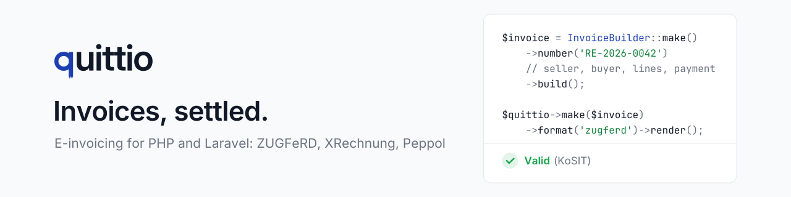

<p align="center">
  <picture>
    <source media="(prefers-color-scheme: dark)" srcset="art/banner-dark.svg">
    
  </picture>
</p>

# Quittio

E-invoicing for Laravel. Quittio creates, validates, reads and renders electronic invoices based on the European standard EN 16931. Germany is the first market; everything country-specific lives in country packs, so the core stays country-neutral.

**Documentation: [quittio.github.io/quittio](https://quittio.github.io/quittio/)**

> **Status:** version 0.1.0 in preparation. The core scope of the roadmap (0.1–0.3) is implemented: data model, calculation, validation L1–L7, CII/UBL writers and readers, ZUGFeRD/Factur-X PDF/A-3, XRechnung, Peppol BIS, Laravel integration and the country pack Germany. The Managed layer 1.0 (issuer profiles, drafts, gapless numbering, archive, cancellations, corrections, mail delivery, audit log) is available as the separate package `quittio/managed`; payments, dunning runs and subscriptions follow later. Not released yet; APIs may still change, and the legal wording must be confirmed by a tax adviser (see open decisions).

## Packages

All open source packages are developed in this repository under [`packages/`](packages/). Each one is also published as a read-only repository for Composer, which a GitHub Action updates on every push and tag.

| Package | Code | Purpose |
|---|---|---|
| `quittio/core` | [`packages/core`](packages/core) → [Quittio/core](https://github.com/Quittio/core) | Country-neutral core: EN 16931 data model, calculation, profiles, CII and UBL writers/readers, ZUGFeRD/Factur-X PDF/A-3, validation. Usable without Laravel. |
| `quittio/laravel` | [`packages/laravel`](packages/laravel) → [Quittio/laravel](https://github.com/Quittio/laravel) | Laravel integration: facade, configuration, Blade templates, commands, testing helpers. |
| `quittio/country-de` | [`packages/country-de`](packages/country-de) → [Quittio/country-de](https://github.com/Quittio/country-de) | Country pack for Germany: UStG mandatory fields, tax presets, XRechnung profiles and BR-DE rules, DIN 5008 letter layouts. |
| `quittio/quittio` | this repository | Everything in one package: core, Laravel integration and the country pack Germany. |
| `quittio/managed` | separate repository (commercial) | Managed layer (commercial licence): issuer profiles, drafts, gapless numbering, archive with hashes, cancellations and corrections, mail delivery, audit log, retention. |

## Requirements

- PHP 8.3 or newer with `ctype`, `dom`, `gd`, `libxml`, `mbstring`, `xmlwriter`, `zlib`; `intl` recommended, `zip` for `quittio:schemas:download`
- Laravel 13 (only for `quittio/laravel`)
- Optional: Java 17+ for the KoSIT validator, veraPDF or Docker for PDF/A checks, `opis/json-schema` for JSON input validation

## Supported formats

| Format | Content |
|---|---|
| `zugferd` / `factur-x` | PDF/A-3 with embedded CII XML (profiles MINIMUM to EXTENDED, XRECHNUNG) |
| `xrechnung-cii`, `xrechnung-ubl` | XRechnung 3.0 as plain XML |
| `cii`, `ubl` | Plain CII or UBL 2.1 XML in any profile |
| `peppol` | UBL according to Peppol BIS Billing 3.0 |
| `pdf`, `html`, `json` | PDF without XML, HTML preview, normalised data model |

## Quick example

```php
use Quittio\Core\Builder\InvoiceBuilder;
use Quittio\Core\Enums\{InvoiceTypeCode, PaymentMeansCode, UnitCode};
use Quittio\Country\DE\Tax\VatPreset;
use Quittio\Laravel\Facades\Quittio;

$invoice = InvoiceBuilder::make()
    ->number('RE-2026-0042')
    ->issueDate('2026-10-03')
    ->type(InvoiceTypeCode::CommercialInvoice)
    ->currency('EUR')
    ->seller(fn ($s) => $s
        ->name('Muster GmbH')
        ->vatId('DE123456789')
        ->address('Hauptstraße 1', '12345', 'Musterstadt', 'DE')
        ->contact('Max Muster', '+49 123 456789', 'rechnung@muster.de')
        ->electronicAddress('rechnung@muster.de', 'EM'))
    ->buyer(fn ($b) => $b
        ->name('Kunde AG')
        ->address('Bahnhofstraße 5', '54321', 'Beispielstadt', 'DE')
        ->electronicAddress('ap@kunde.de', 'EM'))
    ->deliveryDate('2026-09-30')
    ->line(fn ($l) => $l
        ->name('Web development')
        ->quantity(24, UnitCode::Hour)
        ->netPrice('95.00')
        ->vat(VatPreset::Standard19))
    ->paymentTerms(fn ($t) => $t->dueInDays(14))
    ->payment(PaymentMeansCode::SepaCreditTransfer, iban: 'DE02120300000000202051')
    ->build();

$result = Quittio::make($invoice)->format('zugferd')->render();

$result->pdf();   // PDF/A-3 with embedded factur-x.xml
$result->xml();   // CII XML
```

## Documentation

The documentation is published at **[quittio.github.io/quittio](https://quittio.github.io/quittio/)** (with search). The same pages are in [`docs/`](docs/):

- [Getting started](docs/getting-started.md)
- [Building invoices](docs/building-invoices.md)
- [Formats and profiles](docs/formats.md)
- [Validation](docs/validation.md)
- [Templates and design](docs/templates.md)
- [Quotes, delivery notes and other documents](docs/documents.md)
- [Reading incoming invoices](docs/reading.md)
- [Laravel integration](docs/laravel.md)
- [Configuration](docs/configuration.md)
- [Country packs](docs/country-packs.md)
- [Testing](docs/testing.md)
- [Artisan commands](docs/commands.md)
- [Managed layer](docs/managed.md)
- [Field reference](docs/field-reference.md) (generated)

The same pages are published as a website on Cloudflare (`.github/workflows/docs.yml`, Jekyll with the theme Just the Docs; secrets `CLOUDFLARE_API_TOKEN` and `CLOUDFLARE_ACCOUNT_ID`, variable `DOCS_URL`, Worker configuration in `docs/wrangler.jsonc`). Local preview: `cd docs && bundle install && bundle exec jekyll serve`.

## Development

```bash
composer install
composer test        # Pest
composer analyse     # PHPStan, level max
composer lint        # Pint
```

Development happens in this repository. `packages/core`, `packages/laravel` and `packages/country-de` are copied to the read-only repositories `quittio/core`, `quittio/laravel` and `quittio/country-de` on every push and tag (`.github/workflows/split.yml`); open issues and pull requests here.

Official validation (KoSIT validator and veraPDF) runs in CI and locally:

```bash
tools/schemas/download.sh          # KoSIT validator, XRechnung configuration, Peppol rules
tools/fixtures/download.sh         # XRechnung test suite (golden files)
tools/validate-fixtures.sh         # all scenarios through KoSIT and veraPDF
vendor/bin/pest --group=official   # tests that need Java or Docker
vendor/bin/pest --group=visual     # visual regression of the default template (pdftoppm)
tools/visual/check-linux.sh        # the same in a container matching the CI image
php tools/docs/generate.php        # JSON schema and field reference after model changes
```

## Maintenance

- Base rate (Basiszinssatz) values are included up to 1 July 2026 (1.52 %, Deutsche Bundesbank). Add later values to `Quittio\Country\DE\Dunning\BaseRateTable` when published (changes on 1 January and 1 July), or at runtime with `withRate()`; interest for days from 1 January 2027 on is rejected until the next rate is added.
- Code lists follow the EN 16931 Schematron 1.3.16 of the XRechnung configuration 2026-08-31 (`quittio:codelists:update`).

## Open decisions

The following points from the specification are still open and must be clarified with a tax adviser before a stable release. Defaults in the code are placeholders.

1. Sign strategy for cancellations: decided, 381 with positive amounts by default, configurable (`corrections.cancellation_strategy`). The VAT of partial cancellations is rounded cumulatively with the earlier ones, so that all of them together reverse exactly the VAT of the original; a single part may differ by one cent from round2(taxable amount × rate) (within BR-CO-17, noted on the document). The tax adviser should confirm this one-cent alignment.
2. Default strategy for corrections: cancel and reissue by default (country pack Germany), corrected invoice 384 configurable (`quittio-managed.correction.strategy`); to be confirmed by a tax adviser.
3. Boundary between price reductions and a new e-invoice, cash discount in exports.
4. Final invoices: the EN 16931 variant is available in the country pack Germany (`->deductAdvance()`: full service with full VAT, paid advance invoices referenced, deducted in BT-113 and itemised with their VAT per rate, section 14 (5) sentence 2 UStG); still open: the EXTENDED variant and the handling of unpaid advance invoices.
5. Continuing invoices: representation of the payment schedule in XML.
6. Cancellation of self-billed invoices.
7. Additional visualisation PDFs when sending XRechnung.
8. Wording and legal references of the tax presets. Checked against the current law text: small business invoices follow section 34a UStDV (since 2025: "Steuerbefreiung für Kleinunternehmer", no service date required), retention notice section 14b (1) sentence 5 UStG; a final review by a tax adviser is still open.
9. Default dunning fees and flat rates.
10. Licences of bundled XSD files, code lists and fonts.
11. Trademark registration of the name "Quittio" (licence model decided: open core, see below).
12. Order and scope of further country packs.
13. Peppol via access point providers only, or an own access point later.
14. France: which platforms first, scope of e-reporting.
15. When EN 16931-1:2026 becomes the default.
16. Legal review of every country pack by a local tax adviser.

## Licence

Open core: `quittio/core`, `quittio/laravel`, `quittio/country-de` and `quittio/quittio` are released under the MIT licence, see [LICENSE](LICENSE). The Managed layer `quittio/managed` is commercially licensed, see [packages/managed/LICENSE](packages/managed/LICENSE); the licence terms are still to be published.
