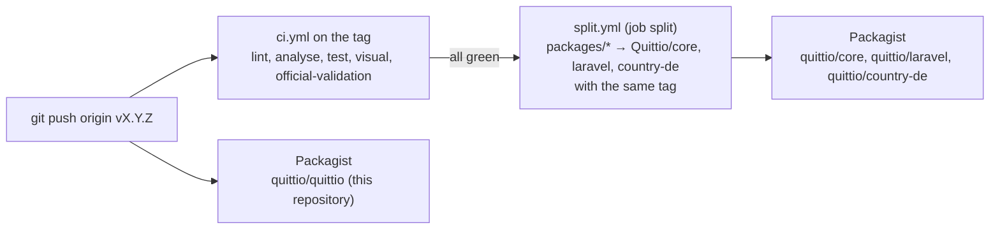

# Releasing

How a version of Quittio gets from `master` to Packagist, and what has to be kept current between releases. All packages are released together with the same version ([ADR 0001](docs/adr/0001-monorepo-with-lockstep-versions.md)).

## How a release flows



- `ci.yml` runs for pushes to `master`, for every tag and for pull requests. Its last job, `split`, calls the reusable workflow `split.yml` only for pushes to `Quittio/quittio`, and only after every other job passed. A red tag therefore never reaches the split repositories.
- `quittio/quittio` is published from this repository itself. Packagist sees its tag as soon as it is pushed, before CI has finished. Push a tag only for a commit whose CI on `master` is green.
- The split needs the repository secret `SPLIT_TOKEN`, a token with "Contents: Read and write" and "Workflows: Read and write" on the three split repositories (classic tokens: the scopes `repo` and `workflow`). The workflow permission is needed because every package contains `.github/workflows/close-pull-request.yml`, which closes pull requests opened in a split repository with a pointer to this one.

## Steps

1. Make sure CI on `master` is green, including `official-validation`.
2. Update `CHANGELOG.md`: rename `[Unreleased]` to `[X.Y.Z] - YYYY-MM-DD` and start a new empty `[Unreleased]` section above it. The format is [Keep a Changelog](https://keepachangelog.com/en/1.1.0/).
3. For a new minor version (e.g. 0.2.0), raise the branch alias of `dev-master` (e.g. `0.2.x-dev`) in all four `composer.json` files: the root and `packages/core`, `packages/laravel`, `packages/country-de`. Update the supported versions in `SECURITY.md` and the status line in `README.md`.
4. Commit as `chore: prepare release X.Y.Z` and push to `master`; wait for CI.
5. Tag and push the tag:

   ```bash
   git tag -a vX.Y.Z -m "X.Y.Z"
   git push origin vX.Y.Z
   ```

6. Wait for CI on the tag. Check that the job `split` passed and that the tag appears in the three split repositories and on Packagist.
7. Create the GitHub release from the tag with the section of the changelog:

   ```bash
   gh release create vX.Y.Z --title "X.Y.Z" --notes-file <(awk '/^## \[X.Y.Z\]/{f=1;next} /^## \[/{f=0} f' CHANGELOG.md)
   ```

If the split of a tag failed (e.g. an expired `SPLIT_TOKEN`), fix the cause and re-run the failed jobs of that CI run; do not move the tag.

## Documentation

`.github/workflows/docs.yml` builds the versioned website with `docs/_versioning/build.mjs` and deploys it to Cloudflare on every push to `master` that changes `docs/`, on every published release and on manual runs:

- `/` shows the latest release tag `vX.Y.Z`, built from the `docs/` of that tag.
- `/next/` shows `master`, with a banner that it is unreleased.
- `/X.Y/` shows every older minor version at its newest patch release.

`llms.txt`, `llms-full.txt` and the MCP index at the root describe the latest release; every version has its own `llms.txt`. Publishing the GitHub release (step 7) triggers the build, so the root switches to the new version only once the release exists. Pull requests build and check `/next/` only, without deploying it. Locally: `cd docs && node _versioning/build.mjs` builds all versions into `docs/_site`.

Secrets and variables: `CLOUDFLARE_API_TOKEN`, `CLOUDFLARE_ACCOUNT_ID` and the variable `DOCS_URL`.

## Maintenance calendar

| When | What | Where |
|---|---|---|
| 1 January and 1 July | New German base rate (Basiszinssatz, section 247 BGB), published by the Deutsche Bundesbank shortly before | Add it to `BaseRateTable::PUBLISHED` (`packages/country-de/src/Dunning/BaseRateTable.php`) and to the README section "Keeping data current" for the next release. Applications get it earlier with `php artisan quittio:base-rate:update`. |
| New XRechnung configuration of KoSIT (usually with a new XRechnung version or Schematron release) | Validator configuration, code lists, test suite | See [Updating the validators](#updating-the-validators), then `php tools/codelists/update.php` and the test suite in `tools/fixtures/download.sh` |
| New Peppol BIS Billing 3.0 release (OpenPeppol publishes several a year) | Peppol Schematron | `PEPPOL_TAG` and checksum, see below |
| New KoSIT validator release | `validator.jar` | `VALIDATOR_VERSION` and checksum, see below |
| Weekly | Dependabot pull requests for the GitHub Actions (pinned commit SHAs), Composer and the gems of the website | `.github/dependabot.yml` |

### Updating the validators

The versions and SHA-256 checksums of the validator artifacts are pinned in two places, which must always agree:

- `packages/core/src/Validation/Drivers/KositArtifacts.php`: `VALIDATOR_VERSION`, `CONFIGURATION_TAG`, `CONFIGURATION_FILE`, `PEPPOL_TAG`, `SCHXSLT_VERSION` and `SHA256` (by download URL), used by `php artisan quittio:schemas:download`.
- `tools/schemas/download.sh`: the same versions and `expected_sha256()`, used by CI, `tools/validate-fixtures.sh` and `tools/docker/kosit`.

The XRechnung test suite is pinned in `tools/fixtures/download.sh` (`TESTSUITE_TAG`, `TESTSUITE_FILE` and its checksum).

To update one of them:

1. Download the new file from its official release page and compute the checksum (`shasum -a 256 <file>`). Compare it with a checksum published by the project, where there is one.
2. Change version and checksum in both places.
3. Run `tools/schemas/download.sh`, `tools/fixtures/download.sh`, `vendor/bin/pest --group=official` and `tools/validate-fixtures.sh`.
4. For a new XRechnung configuration, regenerate the code lists (`php tools/codelists/update.php`) and check the changes of the rules in `docs/validation.md`.
5. Note the new versions in `CHANGELOG.md`.
