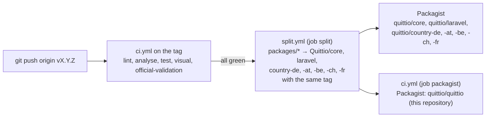

# Releasing

How a version of Quittio gets from `master` to Packagist, and what has to be kept current between releases. All packages are released together with the same version ([ADR 0001](docs/adr/0001-monorepo-with-lockstep-versions.md)).

## How a release flows



- `ci.yml` runs for pushes to `master`, for every tag and for pull requests. Its last job, `split`, calls the reusable workflow `split.yml` only for pushes to `Quittio/quittio`, and only after every other job passed. A red tag therefore never reaches the split repositories.
- `quittio/quittio` is published from this repository itself. The repository has no Packagist webhook; the job `packagist` of `ci.yml` calls the Packagist API after the split, so a tag reaches Packagist only once CI on the tag passed. It needs the repository secrets `PACKAGIST_USERNAME` and `PACKAGIST_TOKEN` (the API token of the Packagist profile). Packagist still crawls packages without a webhook once a week, so push a tag only for a commit whose CI on `master` is green. Do not re-enable the Packagist webhook (Settings → Webhooks) or the GitHub integration of Packagist for this repository.
- The split needs the repository secret `SPLIT_TOKEN`, a token with "Contents: Read and write" and "Workflows: Read and write" on the seven split repositories (classic tokens: the scopes `repo` and `workflow`). The workflow permission is needed because every package contains `.github/workflows/close-pull-request.yml`, which closes pull requests opened in a split repository with a pointer to this one.

## Steps

1. Make sure CI on `master` is green, including `official-validation`.
2. Update `CHANGELOG.md`: rename `[Unreleased]` to `[X.Y.Z] - YYYY-MM-DD` and start a new empty `[Unreleased]` section above it. The format is [Keep a Changelog](https://keepachangelog.com/en/1.1.0/).
3. For a new minor version (e.g. 0.2.0), raise the branch alias of `dev-master` (e.g. `0.2.x-dev`) in all eight `composer.json` files: the root and `packages/core`, `packages/laravel`, `packages/country-de`, `packages/country-at`, `packages/country-be`, `packages/country-ch`, `packages/country-fr`. Update the supported versions in `SECURITY.md` and the status line in `README.md`.
4. Commit as `chore: prepare release X.Y.Z` and push to `master`; wait for CI.
5. Tag and push the tag:

   ```bash
   git tag -a vX.Y.Z -m "X.Y.Z"
   git push origin vX.Y.Z
   ```

6. Wait for CI on the tag. Check that the jobs `split` and `packagist` passed and that the tag appears in the seven split repositories and for all eight packages on Packagist.
7. Create the GitHub release from the tag with the section of the changelog:

   ```bash
   gh release create vX.Y.Z --title "X.Y.Z" --notes-file <(awk '/^## \[X.Y.Z\]/{f=1;next} /^## \[/{f=0} f' CHANGELOG.md)
   ```

If the split of a tag failed (e.g. an expired `SPLIT_TOKEN`), fix the cause and re-run the failed jobs of that CI run; do not move the tag.

## Documentation

quittio.dev/docs renders the documentation from the Markdown files of this repository on GitHub; nothing is built or deployed here:

- `/docs` shows the latest release tag `vX.Y.Z`, from the `docs/` of that tag.
- `/docs/next` shows `master`, with a banner that it is unreleased.
- `/docs/X.Y` shows every older minor version at its newest patch release.

Titles and order of the pages come from `docs/nav.yml`. `llms.txt`, `llms-full.txt` and the MCP server `/docs/mcp` describe the latest release; every version has its own `llms.txt`. `/docs` switches to a new version within ten minutes of its tag; the website keeps the files of a release for a day, those of `master` for ten minutes.

The API reference (`/docs/api`) comes from `.github/workflows/api-reference.yml`: `tools/docs/api.php` writes the public classes as JSON to the branch `docs-api`, `next.json` on every push to `master` that changes `packages/*/src`, `vX.Y.Z.json` when a release is published. Run the workflow by hand to rebuild the files of every release.

## Maintenance calendar

| When | What | Where |
|---|---|---|
| 1 January and 1 July | New German base rate (Basiszinssatz, section 247 BGB), published by the Deutsche Bundesbank shortly before | Add it to `BaseRateTable::PUBLISHED` (`packages/country-de/src/Dunning/BaseRateTable.php`) and to the README section "Keeping data current" for the next release. Applications get it earlier with `php artisan quittio:base-rate:update`. |
| 1 January and 1 July | New reference rates of the other country packs: base rate of the OeNB (Austria), Belgian reference rate of the law of 2 August 2002 (published in the Belgian Official Gazette), ECB main refinancing rate (France); the French legal interest rate (arrêté, published at the end of the half-year before); once a year the Belgian legal interest rate | `BaseRateTable::PUBLISHED` (`packages/country-at`), `ReferenceRateTable::PUBLISHED` (`packages/country-be`), `EcbRateTable::PUBLISHED` and `b2cFixedRate` in `CountryFR::frenchDunningLaw()` (`packages/country-fr`), `b2cFixedRate` in `CountryBE` |
| New XRechnung configuration of KoSIT (usually with a new XRechnung version or Schematron release) | Validator configuration, code lists, test suite | See [Updating the validators](#updating-the-validators), then `php tools/codelists/update.php` and the test suite in `tools/fixtures/download.sh` |
| New Peppol BIS Billing 3.0 release (OpenPeppol publishes several a year) | Peppol Schematron and the Peppol code lists (electronic address schemes, currencies, invoice and credit note type codes) | `PEPPOL_TAG` and checksum, see below; then `php tools/codelists/update.php` |
| New KoSIT validator release | `validator.jar` | `VALIDATOR_VERSION` and checksum, see below |
| Weekly | Dependabot pull requests for the GitHub Actions (pinned commit SHAs), Composer and the gems of the website | `.github/dependabot.yml` |

### Updating the validators

The versions and SHA-256 checksums of the validator artifacts are pinned in two places, which must always agree:

- `packages/core/src/Validation/Drivers/KositArtifacts.php`: `VALIDATOR_VERSION`, `CONFIGURATION_TAG`, `CONFIGURATION_FILE`, `PEPPOL_TAG`, `SCHXSLT_VERSION` and `SHA256` (by download URL), used by `php artisan quittio:schemas:download`.
- `tools/schemas/download.sh`: the same versions and `expected_sha256()`, used by CI, `tools/validate-fixtures.sh` and `tools/docker/kosit`.

The XRechnung test suite is pinned in `tools/fixtures/download.sh` (`TESTSUITE_TAG`, `TESTSUITE_FILE` and its checksum).

To update one of them:

1. Download the new file from its official release page and compute the checksum (`shasum -a 256 <file>`). Compare it with a checksum published by the project, where there is one.
2. Change version and checksum in both places.
3. Run `tools/schemas/download.sh`, `tools/fixtures/download.sh`, `vendor/bin/pest --group=official` and `tools/validate-fixtures.sh`.
4. For a new XRechnung configuration or Peppol release, regenerate the code lists (`php tools/codelists/update.php`; it also writes the Peppol lists `peppol-eas-codes.json`, `peppol-currency-codes.json`, `peppol-invoice-type-codes.json` and `peppol-credit-note-type-codes.json`) and check the changes of the rules in `docs/validation.md`.
5. Note the new versions in `CHANGELOG.md`.
